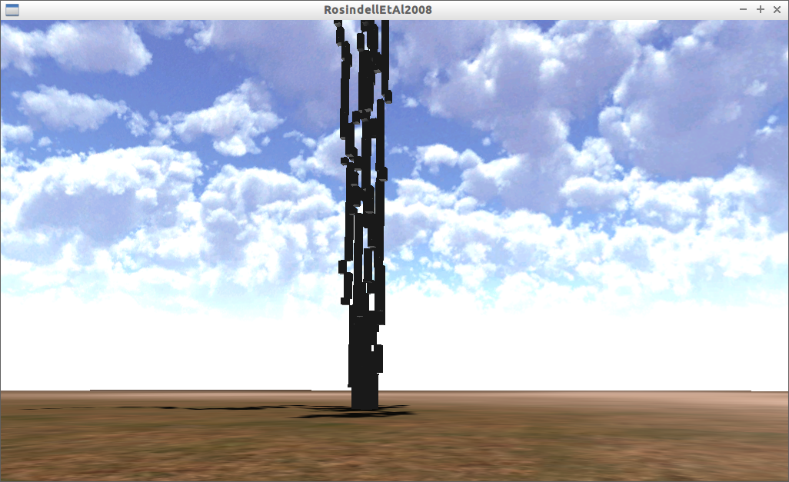

# RosindellEtAl2008

Refactoring and extension of article 'Rosindell, James, Yan Wong, and Rampal S.
Etienne. "A coalescence approach to spatial neutral ecology." Ecological
Informatics 3.3 (2008): 259-271.'.

RosindellEtAl2008 is one of [Richèl Bilderbeek's
tools](https://richelbilderbeek.github.io/tools/).

## Links

- [Source code](https://github.com/richelbilderbeek/RosindellEtAl2008)
- [Richèl Bilderbeek's tools](https://richelbilderbeek.github.io/tools/)
